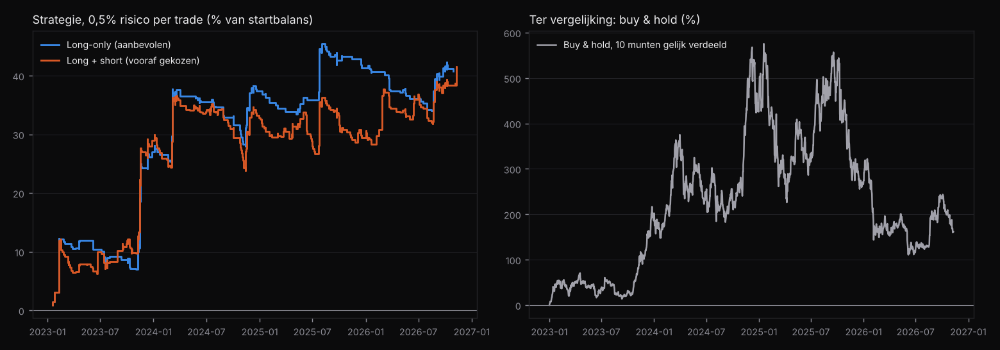

# Strategie-onderzoek en handelsplan: trendvolgen op crypto

*Onderzoek uitgevoerd op 10-11-2026 met de backtest-engine van wng. Geen financieel advies. Een backtest is geen
garantie voor de toekomst.*

## In het kort

Uit 60 geteste varianten kwam één familie steeds bovendrijven: **trendvolgen op de daggrafiek met een meeschuivende
stop**. De vooraf gekozen variant (Bollinger-uitbraak) was ook winstgevend in een periode die bij het kiezen niet
gebruikt is (2023 tot nu). Een toevalstoets gaf ongeveer 3% kans dat dit resultaat toeval is.

| Toetsperiode 2023 – nov 2026 (blind) | Long + short (vooraf gekozen) | Long-only (aanbevolen) |
|---|---|---|
| Trades (10 munten) | 484 | 285 |
| Gemiddeld resultaat per trade | +0,17 R | +0,29 R |
| Winrate | 38% | 39% |
| Gemiddelde winst / verlies | +1,50 R / −0,70 R | +1,78 R / −0,71 R |
| Eén rekening, 0,5% risico per trade | +41% (±11% per jaar) | +41% (±11% per jaar) |
| Grootste tussentijdse daling (0,5% risico) | −12,8% | −11,5% |
| Langste verliesreeks | 24 trades | 19 trades |
| Met dubbele kosten (0,16% per kant) | +0,15 R per trade | +0,27 R per trade |

Buy & hold van dezelfde 10 munten leverde in die periode **+162%**, maar met een tussentijdse daling van **−69%**.
De strategie verdient minder in een sterke stijgende markt, maar beperkt de dalingen veel beter
(rendement/daling ±3,5 tegenover ±2,3).

## Werkwijze

1. **Data**: Binance, 10 munten (BTC, ETH, BNB, XRP, ADA, SOL, DOGE, LTC, LINK, AVAX), dag- en uurcandles van
   2017 (of de notering) tot 9-11-2026. Signalen op dagcandles; de simulatie loopt op uurcandles zodat stop losses
   binnen de dag eerlijk worden geraakt. Raken stop en doel dezelfde candle, dan telt de stop.
2. **Kosten**: 0,08% per kant (handelskosten + slippage). Funding van futures is níet meegenomen.
3. **Ontwikkelperiode (2017 – 2022)**: 60 varianten uit 5 families (Donchian-uitbraak, SMA-kruising,
   EMA-kruising, RSI-terugkeer, Bollinger-uitbraak), met **dezelfde instellingen voor alle munten**.
4. **Keuze vooraf vastgelegd**: hoogste gepoolde t-waarde, met minstens 70% winstgevende munten en 100 trades.
   Gekozen: Bollinger-uitbraak (20, 2), long + short, stop en meeschuivende stop 2× ATR(20).
5. **Toetsperiode (2023 – nu)**: één keer getoetst. Toevalstoets: zelfde exits, willekeurige instapmomenten
   (100 keer). Willekeurige instap gaf gemiddeld +0,07 R; de strategie +0,17 R (p ≈ 0,03).

Reproduceren: `python research/strategy_research.py <data>` en `python research/robustness.py <data>`.
Alle uitkomsten staan in `research/results/`.

## Wat het onderzoek ook liet zien

- **Het effect zit in de familie, niet in één instelling.** Alle trendvolgers die in de ontwikkelperiode goed
  waren, bleven in de toetsperiode winstgevend (+0,16 tot +0,58 R per trade).
- **Terugkeer naar het gemiddelde (RSI) werkte niet** in de toetsperiode (−0,02 R per trade). Die valt af.
- **Short-trades voegden in de toetsperiode niets toe** (−5 R over 210 trades); alle winst kwam van long-trades.
  Daarom is long-only de praktische aanbeveling. Let op: dat is een conclusie ná het bekijken van de toetsperiode,
  dus minder hard bewijs. Toets het eerst op papier (zie hieronder).
- **Niet elk jaar is winstgevend.** Long + short per jaar: 2023 +58 R, 2024 +8 R, 2025 −7 R, 2026 +24 R.
  Na de sterke start schoof het resultaat bijna twee jaar zijwaarts. Reken daarop.

## Het handelsplan

### Regels (long-only, dagcandles)
| | |
|---|---|
| Markten | BTC, ETH, BNB, XRP, ADA, SOL, DOGE, LTC, LINK, AVAX (spot, tegen USDT/USD) |
| Moment | Eén keer per dag, direct na de dag-close (00:00 UTC) |
| Instap | De dag-close kruist **boven** de bovenste Bollinger Band (20 dagen, 2 standaardafwijkingen) |
| Eerste stop | Instapprijs − 2 × ATR(20) |
| Meeschuivende stop | Elke dag na de close: nieuwe stop = close − 2 × ATR(20), maar alleen als die **hoger** is dan de oude |
| Uitstap | Alleen via de stop (geen vast koersdoel), als stop-order op de exchange |
| Posities | Maximaal 1 per munt, dus maximaal 10 tegelijk |

### Positiegrootte
- Risico per trade: **0,5% van je rekening** (historisch ±−12% tussentijdse daling; reken voor de toekomst op het
  dubbele).
- Aantal munten = (rekening × 0,005) / (2 × ATR). Bij een ATR van ±4% is de positie ±6% van je rekening: geen
  hefboom nodig.
- Totaal risico met 10 open posities: maximaal 5%. Crypto beweegt sterk samen; meer is af te raden.

### Verwachtingen (op basis van 2023 – 2026)
- ±39% van de trades is winst; een winnaar is gemiddeld ±2,5× zo groot als een verliezer.
- Verliesreeksen van **15 – 25 trades** zijn normaal. Ook **periodes van een jaar of langer zonder nieuwe top**.
- In een sterke stijgende markt verdient buy & hold meer. De strategie is er om grote dalingen te beperken.

### Stopregels voor jezelf
1. **Eerst 3 maanden op papier** (of met een heel klein bedrag) in wng of een spreadsheet. Vergelijk elke trade
   met wat de backtest zou doen.
2. **Pauzeer en evalueer** als de tussentijdse daling groter wordt dan −25% (2× historisch), of als het gemiddelde
   na 100 echte trades negatief is.
3. **Geen handmatige uitzonderingen**: geen trades overslaan of stops verzetten. Juist de paar grote winnaars
   (tot +13 R) maken het resultaat.
4. **Elk kwartaal** de backtest bijwerken met nieuwe data; verander de regels niet na een paar slechte trades.

### Grenzen van dit onderzoek
- Eén marktsoort (crypto) en één bron (Binance). Goud, forex en indices zijn niet getest (geen data beschikbaar).
- 60 varianten getest: een deel van het resultaat in de ontwikkelperiode is geluk door selectie. De toetsperiode
  corrigeert daarvoor, maar 3,9 jaar is kort.
- Funding (bij futures), belasting en uitvoeringsproblemen (storingen, gaten) zijn niet meegenomen.

## In wng
De strategie staat als sjabloon **"Trendvolger – Bollinger-uitbraak (dag)"** in wng onder *Strategieën → Sjablonen*.
Download crypto-data via *Data → Downloaden* (1D sinds 2017 + 1H) en backtest hem zelf.
